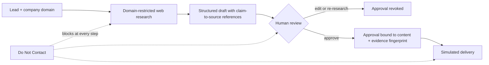

# SignalDesk

**Evidence before outreach. Humans keep the authority.**

An SDR research and draft-review workspace where every claim in a draft points to a source, every approval is bound to the exact content that was reviewed, and a Do Not Contact decision cannot be overridden by anything, including in-flight AI research.

   

> **Scope, stated up front:** local, single-user prototype. Seven fictional demo leads, plus optional live OpenAI web research for leads you enter. Email delivery is always simulated. Not for public hosting or sensitive customer records.

---

## Why this exists

A fast outreach draft is worthless if it invents a relationship, misidentifies a contact, or ignores a decision not to contact someone. Most AI SDR tooling optimizes for volume. SignalDesk optimizes for **authority and evidence**: the AI proposes, a human reviews the sources, and the system enforces what the human decided.



## Product walkthrough

**Review queue and decision counts**

*Fictional Meridian Field Services demo. Counts reflect a local test workspace; delivery remains simulated.*

**Evidence beside the draft**

*Source M1 sits beside the draft and its claim reference. The approval event records the reviewed version; saving edits revokes approval. Other queue entries belong to the local test workspace and do not imply customer relationships or endorsements.*

**Do Not Contact takes priority**

*Brightfield is a preloaded suppressed fixture. Potential business fit does not override Do Not Contact: approval and simulated delivery are blocked. Its empty decision history reflects the seeded state, not a newly recorded suppression action.*

## Design decisions

| Decision | Why | Boundary |
|---|---|---|
| Fixed research → structured draft workflow | Keeps tool use and failure paths bounded | No autonomous outreach loop |
| Company-domain research only | Narrows the source surface | Company pages can still be incomplete or stale |
| Approval bound to content and evidence | An old approval cannot authorize changed material | Edits and new research revoke approval |
| Persistent suppression | Preserves the human decision not to contact | Suppression wins over in-flight research |
| Simulated delivery | Demonstrates authorization without contacting prospects | No email provider integrated |

## What is enforced vs. what still needs a human

| Enforced in code | Still requires human review |
|---|---|
| Approval fingerprint covers recipient, subject, body, sources, and claims | Whether a cited source actually proves the claim |
| Edits and new research revoke approval | Seller and prospect claims in the draft |
| Compare-and-swap blocks stale writes | Source freshness (dates show retrieval, not publication) |
| Suppression during research prevents the returning draft from overwriting it | Prompt-injection defense beyond the pre-labeled fixture |
| Claim references must resolve to returned URL citations | Semantic coverage of claim references (prompt-level only) |
| Interrupted research stays on hold | Cost: caps are run limits, not dollar guarantees |

## Governance mapping

How SignalDesk's controls line up with the four functions of the [NIST AI Risk Management Framework](https://www.nist.gov/itl/ai-risk-management-framework). This is an illustrative alignment of a prototype, **not** a compliance claim or formal assessment.

| RMF function | SignalDesk control | Known gap |
|---|---|---|
| **Govern**: accountability and human oversight | A human decision is the only path to simulated delivery. Do Not Contact is persistent and outranks every other state. Approvals and decisions are recorded as events. | No authentication or roles. History is an editable database, not an immutable audit archive. |
| **Map**: context and scope of risk | Research is limited to the entered company domain. Fictional fixtures are labeled. Conflicting identity evidence (Cedarline) blocks approval. ICP gates are explicit. The user acknowledges that source context goes to OpenAI before any live run. | Single-user. No stakeholder or impact assessment. |
| **Measure**: testing and evidence | 40 automated tests with mocked provider responses. Token usage and search counts are logged per run. Claim references are validated against actual returned citations. | No accuracy benchmark. A valid reference does not prove the claim. A human-reviewed evaluation against a single-prompt baseline is the next step. |
| **Manage**: controls and response | Edits and new research revoke approval. Approval is bound to a content and evidence fingerprint. Run caps (20 per day, 3 per lead), disabled retries, compare-and-swap, interrupted runs held, and suppression that beats in-flight research. | No monitoring, alerting, incident response, or durable job queue. |

**Design principle:** the model may propose, but it cannot authorize. Authority stays with a named human decision, and the system verifies that the decision still matches the current evidence before acting.

## Quick start

Validated on macOS. Python 3.

```bash
python3 -m venv .venv
source .venv/bin/activate
python -m pip install -e '.[dev]'
python configure_openai.py          # optional: skip to use fictional fixtures, no API calls
python -m uvicorn app.main:app --host 127.0.0.1 --port 8000
```

Open <http://127.0.0.1:8000>. Configuration stores your key locally in `.env` with restricted permissions; never share or commit it. Environment variables override `.env`. Restart after changing configuration.

Keep the app bound to loopback with a single worker. There is no authentication, tenant isolation, or durable job queue.

**Upgrading?** Follow [docs/UPGRADE.md](docs/UPGRADE.md) to preserve your decisions and database. Do not replace your project directory with the release directory.

## Try the workflow

1. **Approve, then edit.** Inspect Meridian's draft and sources, approve it, edit it, and watch approval revoke.
2. **Missing evidence blocks approval.** Cedarline has conflicting identity evidence.
3. **Suppress.** Mark a lead Do Not Contact, refresh, and confirm it persists.
4. **Go live.** Add a lead with company domain, known contact, your offer, and fit criteria. No request is made until you run live research. Limited public evidence may correctly result in a hold.
5. **Review like a human.** Open the source links, check every claim, then edit or approve. Recipients remain reserved `example.com` placeholders.

Requesting more evidence records a question; for a live lead, run research again to use it. Fictional leads cannot trigger live web research.

## Architecture

FastAPI and SQLAlchemy persist leads, revisions, decisions, and research runs. The interface is HTML/CSS/JavaScript.

**Research** uses the OpenAI Responses API with web search restricted to the entered company domain, followed by structured drafting without tools.

- At most two response calls and two search-tool calls per run; each response bounded to 4,000 output tokens
- Automatic retries disabled
- Local persisted caps: 20 runs per UTC day and 3 per lead, failed attempts included
- Token usage and search counts are logged; check your API dashboard for actual charges, including requests interrupted before usage was returned

**Citations** come from actual returned URL citations. Claim references must point to those source IDs. This validates references, not whether a source proves a claim. Source cards show reference links and a verification reminder rather than clipped AI prose.

Full detail: [Architecture](docs/ARCHITECTURE.md)

## Data and limitations

- Default database is `signaldesk.db` in the directory where you start the server. Do not delete it if you want to keep decisions.
- Source context goes to OpenAI only for a live run, after you acknowledge this on lead creation. Responses use `store=False`; this is not a claim of zero provider retention.
- Local history is an ordinary editable database, not an immutable compliance archive.
- Content flags are incomplete heuristics. The malicious fixture is pre-labeled and does not demonstrate a general prompt-injection defense.
- `DATABASE_URL` can select PostgreSQL (`postgresql+psycopg://...`). PostgreSQL, multiple workers, schema migrations, and hosted deployment are unvalidated.
- Default model is `gpt-5-mini`, changeable via the configuration script. Model and tool availability depend on your API account.

## Validation

```bash
python -m pytest -q
```

- 40 automated tests passed locally, using mocked provider responses
- User-operated Mac checks confirmed the v0.3.1 label, saved-draft persistence, and persistent Do Not Contact
- One live run completed successfully. These are functional observations, not measured sales lift or a research-accuracy benchmark

See [Validation](docs/VALIDATION.md) for the tested boundary and [Product brief](docs/PRODUCT_BRIEF.md) for the product hypothesis.

## Roadmap

**Next:** a small human-reviewed live evaluation against a single-prompt baseline, then validation of review time and willingness to pay.

**Future work:** authentication, tenant isolation, durable workers, CRM integrations, pgvector, real delivery.

## Changelog

**v0.3.1**
- Corrects the displayed release version and the documented output-token limit
- Tightens drafting instructions so claim references cover prospect facts used in the subject and body, including business operations; qualification-only facts stay in the rationale. This prompt change has not been live-evaluated and does not enforce semantic coverage in code
- The updater preserves saved drafts and decisions. Re-running research replaces the current draft and revokes approval; event history does not keep complete prior draft text, so use a separate lead for experiments

**v0.3**
- Consolidates working v0.2 patches: 4,000 output tokens per response, low reasoning for gpt-5-mini, bounded search, diagnostic error labels, explicit ICP gates
- Drafting instructions prohibit seller track-record assertions and treat the offer as proposed capabilities only. This is a prompt-level mitigation, not a factual verifier
- Source cards show neutral reference descriptions; stored research is unchanged. Live fit review is labeled AI-assisted rather than rule-based

## References

[Web search guide](https://developers.openai.com/api/docs/guides/tools-web-search) · [Structured outputs guide](https://developers.openai.com/api/docs/guides/structured-outputs) · [Release checklist](docs/REPOSITORY_CHECKLIST.md)

## License

No license is included in this release.
