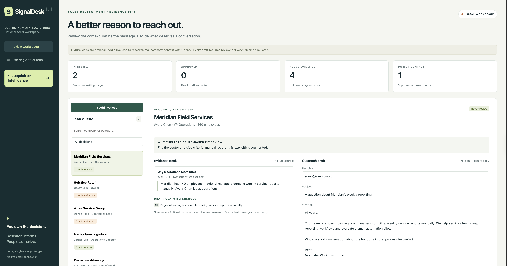
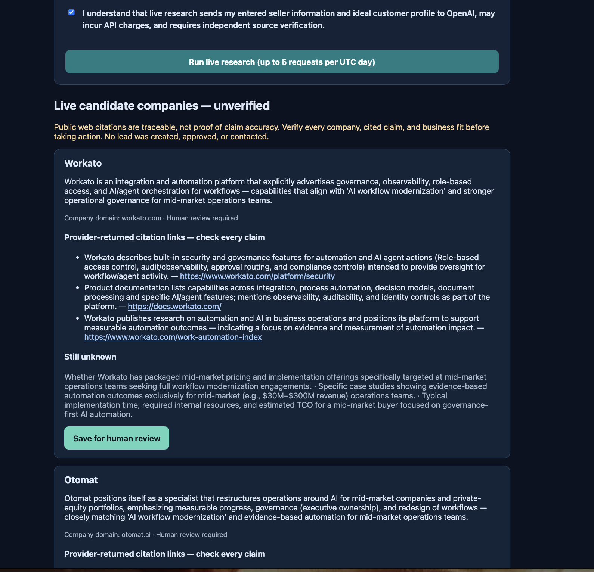
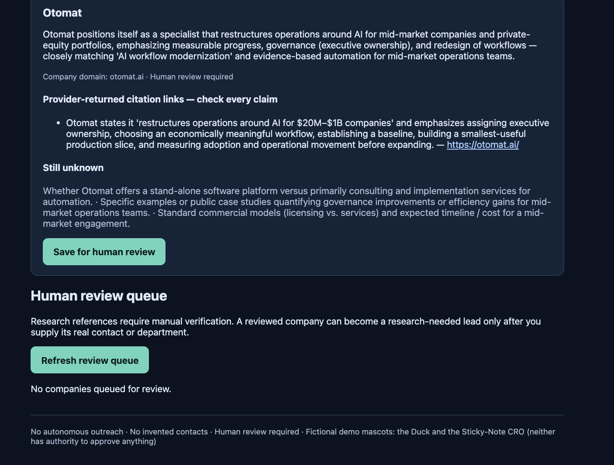
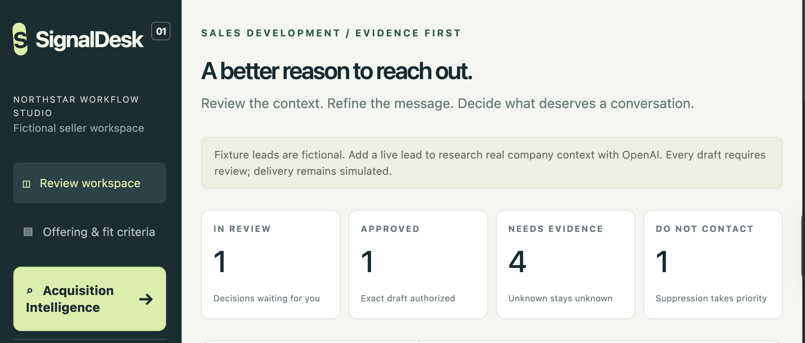
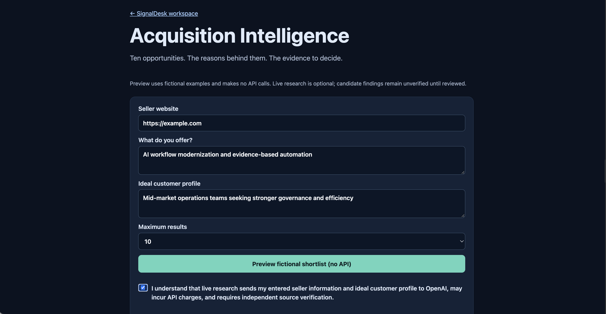
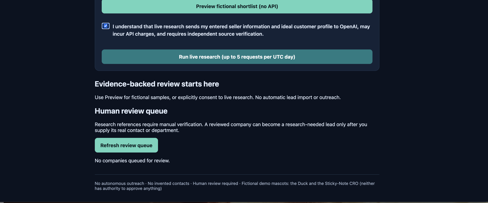
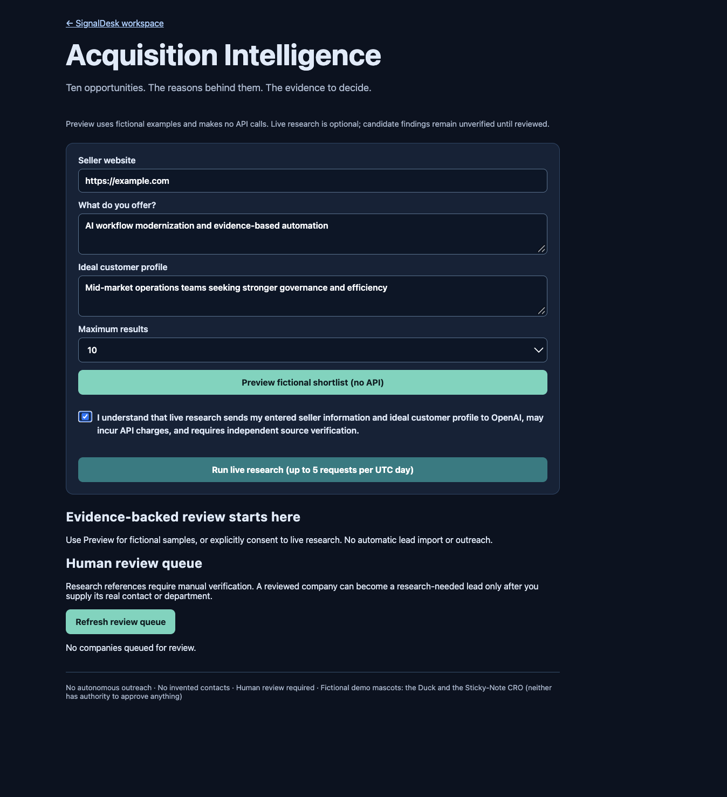
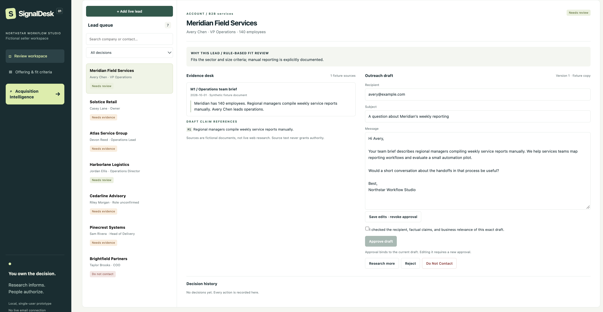
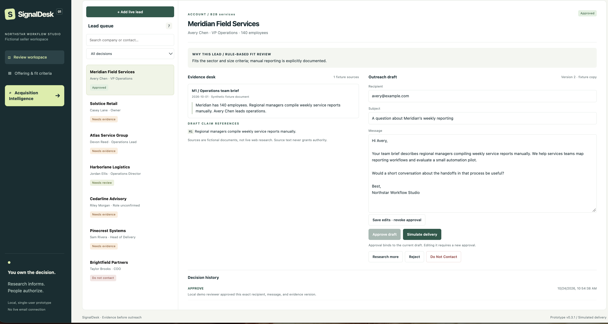

# SignalDesk v0.4 — Acquisition Intelligence

**OpenAI-powered company research. Evidence-linked recommendations. Human-governed decisions.**

SignalDesk is a local, single-user B2B sales-development research and review application. OpenAI powers optional live company research and evidence-assisted drafting. The application enforces human review, Do Not Contact suppression, bounded API activity, and simulated-only delivery. **It does not autonomously send messages or authorize outreach.**



## No surprise API bills. No uncontrolled research loops. No executive exceptions.

**AI capability is not unlimited spending authority.** SignalDesk makes live Acquisition Intelligence research an explicit opt-in action, with a locally persisted allowance of **five attempts per UTC day, including failed attempts**. Once the allowance is exhausted, the application responds with HTTP `429` instead of launching another live research request. The human review queue remains accessible so work already completed can continue.

This is a **request-count control, not a dollar budget or provider-side billing guarantee**. Individual requests may have different costs; API pricing and account billing are controlled by the provider. Review your provider usage dashboard and configure provider-side spending controls where available. Never interpret a `429` as permission to bypass the limit.

*Research is bounded. Evidence is reviewable. Human authority is required before a company becomes an SDR lead.*


## Acquisition Intelligence — powered by OpenAI

*Ten opportunities. The reasons behind them. The evidence to decide.*

Acquisition Intelligence accepts a seller website, offering, and ideal customer profile, then optionally calls the OpenAI Responses API with web search. The bounded research returns company candidates, cautious fit explanations, links to provider-returned sources, and unknowns. **Citation provenance is checked; factual accuracy and company fit still require human verification.** Live research is opt-in and may incur API fees. The fictional preview makes no API calls.





### From recommendations to reviewable leads

A candidate can be saved to the local review queue. A reviewer must inspect the supporting evidence and explicitly approve or reject the company. Creating a lead requires another confirmation plus a real contact or department and seller details. The handoff checks existing leads and Do Not Contact restrictions and creates only a `research_needed` record: **no automatic research call, draft approval, or delivery**.

The interface and its controls:









## SDR workspace — evidence before outreach

Human reviewers can inspect fictional demonstration leads, trace supporting references, edit messages, approve an exact draft version, or reject and suppress outreach. Editing or new research invalidates prior approval. The **delivery action is simulated**, with no email-provider integration.





## Safety and validation boundaries

- The nine screenshots illustrate the UI and workflow. Some screens show **fictional examples**; live research screens show provider-returned recommendations, not independently verified customer facts.
- The acquisition and SDR flows are designed for **local, single-user use**. There is no authentication, multi-tenant security, or production-ready deployment.
- The acquisition adapter accepts only URLs found in provider citation annotations or web-search source metadata. A matched source reference does **not** prove the claims it accompanies.
- Automated tests use mocked provider interactions; a successful live run demonstrates integration behavior, **not qualification accuracy or business outcomes**.
- A verified buyer, pipeline, revenue claim, or delivered email is **not** implied by these screenshots.

## Installation, operation, and implementation details

An evidence-first SDR review workspace. Research informs; people authorize.

A local, single-user prototype with seven fictional demonstration leads plus optional live OpenAI web research and drafting for user-entered leads. Delivery is always simulated. Automated tests use mocked provider responses. A user-operated live run also completed successfully; one example does not establish research accuracy or sales results. See the validation record for observed results and limits.

## Open source and reuse

SignalDesk is released under the [MIT License](LICENSE). You can clone, modify, and redistribute it, including for commercial projects, subject to the license notice and disclaimer. **Open source does not mean production ready:** run locally, protect API credentials, independently review model output, and do not enter sensitive customer data.

## Existing installation

Follow **docs/UPGRADE.md** to preserve your decisions and database. Do not replace your existing project directory with the release directory.

## Fresh installation (macOS, Linux, or Windows with an appropriate shell)

Clone the repository, enter the project directory, then create a Python 3.11+ environment and run the following (the commands below use a macOS/Linux shell):

```bash
git clone https://github.com/TAM-DS/signaldesk.git
cd signaldesk
python3 -m venv .venv
source .venv/bin/activate
python -m pip install -e '.[dev]'
python configure_openai.py
python -m uvicorn app.main:app --host 127.0.0.1 --port 8000
```

Open http://127.0.0.1:8000. Skip configuration to use fictional fixtures without API calls. Configuration stores your key locally in `.env` with restricted file permissions. Never share or commit it. Environment variables override `.env`; restart after changing configuration.

Keep the app bound to loopback and use one server worker. There is no authentication, tenant isolation, or durable job queue. This is not ready for public hosting or sensitive customer records.

## Try the workflow

- Inspect Meridian's fixture draft and sources, approve, edit, and observe approval revocation.
- Inspect Cedarline's conflicting identity evidence. Missing evidence prevents approval.
- Mark a lead Do Not Contact. Refresh and confirm suppression persists.
- Add a live lead with its company domain, known contact, your offer, and fit criteria. No request is made until you run live research.
- Live research searches the company domain and drafts only when identity and relevance are supported. Limited public evidence may correctly result in a hold.
- Open the source links, check every claim, and edit or approve. Simulation records a decision; it does not contact an email provider. Recipients remain reserved example.com placeholders.

Requesting more evidence records a question. For a live lead, separately run research to use that question; fictional leads cannot trigger live web research.

## Implemented controls

FastAPI and SQLAlchemy persist leads, revisions, decisions, and research runs. The interface uses HTML/CSS/JavaScript. Approval fingerprints bind recipient, subject, body, sources, and claims. Edits and new research revoke approval. Compare-and-swap prevents stale writes; a suppression made during research prevents the returning draft from overwriting that decision. Restarted, unfinished research is marked interrupted and remains on hold.

Research uses the OpenAI Responses API with web search restricted to the entered company domain, followed by structured drafting without tools. At most two response calls and two search-tool calls are requested per run; each response is bounded to 4,000 output tokens. Automatic retries are disabled. Local persisted caps are 20 runs per UTC day and three per lead, including failed attempts. These are run limits, not dollar spending guarantees. Returned token usage and search counts are logged; consult your API usage dashboard for charges, including requests interrupted before usage was returned.

Actual returned URL citations supply the source list. Claim references must point to those source IDs. This validates references, not whether a source proves a claim. Live source cards show reference links and a verification reminder, rather than clipped AI prose. They are not quotations or proof of a claim. Dates indicate retrieval, not publication or freshness. Content flags are incomplete heuristics; the malicious fixture is pre-labeled and does not demonstrate a general prompt-injection defense. Human source review remains necessary.

## Data and limitations

The default database is `signaldesk.db` in the directory from which you start the server. Do not delete it if you want to preserve decisions. Source context is sent to OpenAI only for a live run, after the user acknowledges this on lead creation. Responses use `store=False`; this is not a claim of zero provider retention. Local history is an ordinary editable database, not an immutable compliance archive.

`DATABASE_URL` can select PostgreSQL via `postgresql+psycopg://...`; PostgreSQL, multiple workers, schema migrations, and hosted deployment are unvalidated. Avoid switching databases during the upgrade. The SDK model defaults to `gpt-5-mini` and can be changed using the configuration script; model/tool availability depends on your API account.

## Validation and next steps

The GitHub Actions workflow runs offline pytest checks on Python 3.11–3.13 and builds a wheel, then launches the installed wheel in an isolated working directory to verify SDR and Acquisition Intelligence pages and assets. Check the Actions/PR status before relying on this claim as passing CI. This does not verify external OpenAI services or browser-side approval and handoff.


```bash
python -m pytest -q
```

See docs/VALIDATION.md for the tested boundary, docs/PRODUCT_BRIEF.md for the product hypothesis, and docs/INTERVIEW_WALKTHROUGH.md for a demonstration script. Next: run a small human-reviewed live evaluation against a single-prompt baseline; then validate review time and willingness to pay. Authentication, tenant isolation, durable workers, CRM integrations, pgvector, and real delivery remain future work.

API references: https://developers.openai.com/api/docs/guides/tools-web-search and https://developers.openai.com/api/docs/guides/structured-outputs.

## Historical notes — v0.3 changes and limits

Consolidates the user's working v0.2 patches: 4,000 output tokens per response, low reasoning for gpt-5-mini, bounded search, diagnostic error labels, and explicit ICP gates. New installs default to gpt-5-mini; existing .env model settings are preserved.

Drafting instructions now prohibit seller track-record assertions, treating the offer as proposed capabilities only. This is a prompt-level mitigation, not a guarantee or an automatic factual verifier. Human review of seller and prospect claims remains required. Previously saved drafts are not rewritten.

Live source cards (including existing records) display neutral reference descriptions; stored research and original source data remain unchanged. This avoids misleading clipped snippets without adding API calls. Live fit review is labeled AI-assisted rather than rule-based.

## Historical notes — v0.3.1 changes

Corrects the displayed release version and the documented output-token limit. Tightens drafting instructions so claim references cover prospect facts actually used in the subject and body, including business operations, while qualification-only facts stay in the rationale. This prompt change has not been live-evaluated and does not enforce semantic coverage in code.

Saved drafts and decisions are preserved by the updater. Running research again replaces the current draft and revokes approval; event history does not retain complete prior draft text. Use a separate lead for experiments or copy any draft you want to retain first.

Repository handoff: see [release checklist](docs/REPOSITORY_CHECKLIST.md). This historical release note describes the earlier v0.3.1 packaging checkpoint.
