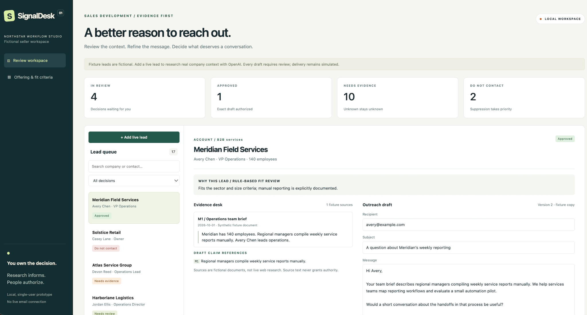
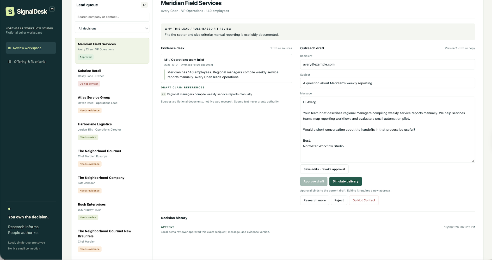
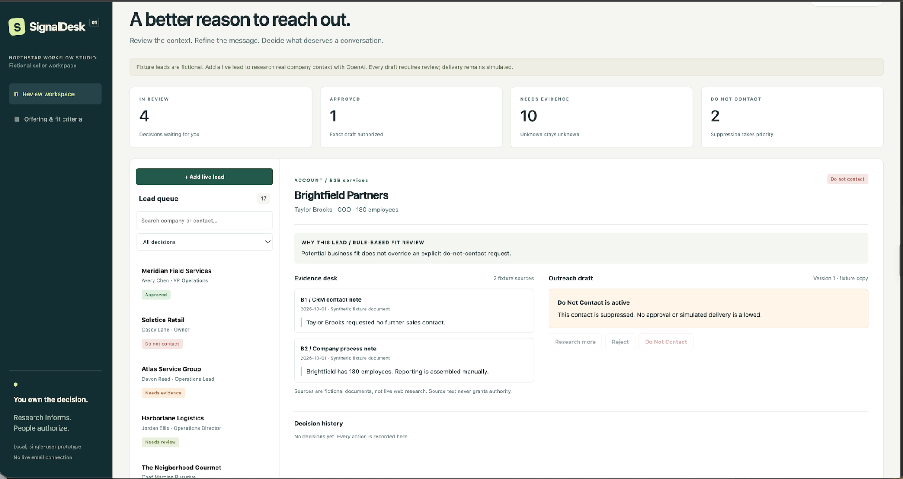

# SignalDesk

**Evidence before outreach. Humans keep the authority.**

An SDR research and draft-review workspace built around source review, explicit human approval, and persistent Do Not Contact controls. Version 0.3.1.

A local, single-user prototype with seven fictional demonstration leads plus optional live OpenAI web research and drafting for user-entered leads. Delivery is always simulated. Automated tests use mocked provider responses. A user-operated live run also completed successfully; one example does not establish research accuracy or sales results. See the validation record for observed results and limits.

## Product walkthrough



*Fictional Meridian Field Services demo: review queue, decision counts, source evidence, and an approved draft. Counts reflect a local test workspace; delivery remains simulated.*

### Evidence beside the draft



*The selected Meridian fixture shows source M1 beside the draft and its claim reference. The approval event records the reviewed version; saving edits revokes approval. Other queue entries belong to the local test workspace and do not imply customer relationships or endorsements.*

### Do Not Contact takes priority



*Brightfield is a preloaded suppressed fixture. Potential business fit does not override Do Not Contact: approval and simulated delivery are blocked. Its empty decision history reflects the seeded state, not a newly recorded suppression action.*

## The business problem

A fast outreach draft is not useful if it invents a relationship, misidentifies a contact, or ignores a decision not to contact someone. SignalDesk makes research, evidence gaps, draft review, and authorization visible in one local workflow.

## Key decisions

| Decision | Reason | Boundary |
| --- | --- | --- |
| Fixed research → structured draft workflow | Keep tool use and failure paths bounded | No autonomous outreach loop |
| Company-domain research | Narrow the source surface | Company pages can still be incomplete or stale |
| Approval bound to content and evidence | Prevent an old approval from authorizing changed material | Edits and new research revoke approval |
| Persistent suppression | Preserve the human decision not to contact | Suppression takes priority over in-flight research |
| Simulated delivery | Demonstrate authorization without contacting prospects | No email provider is integrated |

**Evidence:** 40 automated tests passed locally; user-operated Mac checks confirmed the v0.3.1 label, saved-draft persistence, and persistent Do Not Contact. One observed live run completed. These are functional observations, not measured sales lift or a research-accuracy benchmark.

[Architecture](docs/ARCHITECTURE.md) · [Validation](docs/VALIDATION.md) · [Product brief](docs/PRODUCT_BRIEF.md) · [Interview walkthrough](docs/INTERVIEW_WALKTHROUGH.md)

## Existing installation

Follow **docs/UPGRADE.md** to preserve your decisions and database. Do not replace your existing project directory with the release directory.

## Fresh installation on your Mac

Open this folder in PyCharm and run:

```bash
python3 -m venv .venv
source .venv/bin/activate
python -m pip install -e '.[dev]'
python configure_openai.py
python -m uvicorn app.main:app --host 127.0.0.1 --port 8000
```

Open http://127.0.0.1:8000. Skip configuration to use fictional fixtures without API calls. Configuration stores your key locally in `.env` with restricted file permissions. Never share or commit it. Environment variables override `.env`; restart after changing configuration.

Keep the app bound to loopback and use one server worker. There is no authentication, tenant isolation, or durable job queue. This is not ready for public hosting or sensitive customer records.

## Try the workflow

- Inspect Meridian's fixture draft and sources, approve, edit, and observe approval revocation.
- Inspect Cedarline's conflicting identity evidence. Missing evidence prevents approval.
- Mark a lead Do Not Contact. Refresh and confirm suppression persists.
- Add a live lead with its company domain, known contact, your offer, and fit criteria. No request is made until you run live research.
- Live research searches the company domain and drafts only when identity and relevance are supported. Limited public evidence may correctly result in a hold.
- Open the source links, check every claim, and edit or approve. Simulation records a decision; it does not contact an email provider. Recipients remain reserved example.com placeholders.

Requesting more evidence records a question. For a live lead, separately run research to use that question; fictional leads cannot trigger live web research.

## Implemented controls

FastAPI and SQLAlchemy persist leads, revisions, decisions, and research runs. The interface uses HTML/CSS/JavaScript. Approval fingerprints bind recipient, subject, body, sources, and claims. Edits and new research revoke approval. Compare-and-swap prevents stale writes; a suppression made during research prevents the returning draft from overwriting that decision. Restarted, unfinished research is marked interrupted and remains on hold.

Research uses the OpenAI Responses API with web search restricted to the entered company domain, followed by structured drafting without tools. At most two response calls and two search-tool calls are requested per run; each response is bounded to 4,000 output tokens. Automatic retries are disabled. Local persisted caps are 20 runs per UTC day and three per lead, including failed attempts. These are run limits, not dollar spending guarantees. Returned token usage and search counts are logged; consult your API usage dashboard for charges, including requests interrupted before usage was returned.

Actual returned URL citations supply the source list. Claim references must point to those source IDs. This validates references, not whether a source proves a claim. Live source cards show reference links and a verification reminder, rather than clipped AI prose. They are not quotations or proof of a claim. Dates indicate retrieval, not publication or freshness. Content flags are incomplete heuristics; the malicious fixture is pre-labeled and does not demonstrate a general prompt-injection defense. Human source review remains necessary.

## Data and limitations

The default database is `signaldesk.db` in the directory from which you start the server. Do not delete it if you want to preserve decisions. Source context is sent to OpenAI only for a live run, after the user acknowledges this on lead creation. Responses use `store=False`; this is not a claim of zero provider retention. Local history is an ordinary editable database, not an immutable compliance archive.

`DATABASE_URL` can select PostgreSQL via `postgresql+psycopg://...`; PostgreSQL, multiple workers, schema migrations, and hosted deployment are unvalidated. Avoid switching databases during the upgrade. The SDK model defaults to `gpt-5-mini` and can be changed using the configuration script; model/tool availability depends on your API account.

## Validation and next steps

```bash
python -m pytest -q
```

See docs/VALIDATION.md for the tested boundary, docs/PRODUCT_BRIEF.md for the product hypothesis, and docs/INTERVIEW_WALKTHROUGH.md for a demonstration script. Next: run a small human-reviewed live evaluation against a single-prompt baseline; then validate review time and willingness to pay. Authentication, tenant isolation, durable workers, CRM integrations, pgvector, and real delivery remain future work.

API references: https://developers.openai.com/api/docs/guides/tools-web-search and https://developers.openai.com/api/docs/guides/structured-outputs.

## v0.3 changes and limits

Consolidates the user's working v0.2 patches: 4,000 output tokens per response, low reasoning for gpt-5-mini, bounded search, diagnostic error labels, and explicit ICP gates. New installs default to gpt-5-mini; existing .env model settings are preserved.

Drafting instructions now prohibit seller track-record assertions, treating the offer as proposed capabilities only. This is a prompt-level mitigation, not a guarantee or an automatic factual verifier. Human review of seller and prospect claims remains required. Previously saved drafts are not rewritten.

Live source cards (including existing records) display neutral reference descriptions; stored research and original source data remain unchanged. This avoids misleading clipped snippets without adding API calls. Live fit review is labeled AI-assisted rather than rule-based.

## v0.3.1 changes

Corrects the displayed release version and the documented output-token limit. Tightens drafting instructions so claim references cover prospect facts actually used in the subject and body, including business operations, while qualification-only facts stay in the rationale. This prompt change has not been live-evaluated and does not enforce semantic coverage in code.

Saved drafts and decisions are preserved by the updater. Running research again replaces the current draft and revokes approval; event history does not retain complete prior draft text. Use a separate lead for experiments or copy any draft you want to retain first.

Repository maintenance: see [release checklist](docs/REPOSITORY_CHECKLIST.md). No license is included in this release.
