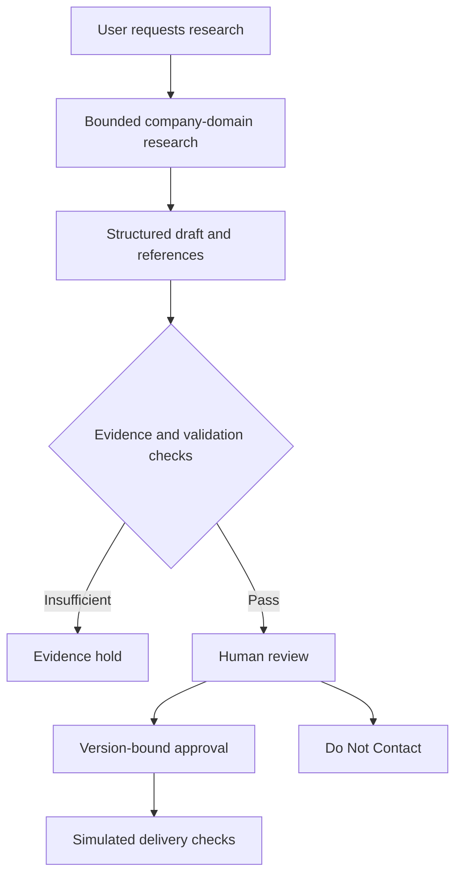

# Architecture and authority

SignalDesk uses a fixed workflow with two bounded OpenAI response calls, rather than a team of autonomous agents. FastAPI serves the API and static interface. SQLAlchemy persists current lead state, decisions, and research runs in SQLite by default.

## Control ownership

The model proposes fit assessments, draft text, and claim references. The application validates the schema and source IDs, stores state, and requires review before approval. A human must inspect the linked pages and decide whether the claims are supportable. Schema validity and source-ID membership do not establish truth.

Approval fingerprints bind the recipient, subject, body, source records, and claim records. Edits or a new research run revoke approval. Revision checks reject stale writes. A suppression decision made while research is running wins over its returning result. Simulation checks the approval against current content; it has no email-provider integration.

## Failure behavior

Provider failures and incomplete research produce an evidence hold rather than an approved draft. The app records returned usage when available; interrupted calls may incur costs without complete local usage records. Persisted run caps constrain attempts, not dollar spend. Restart recovery marks unfinished research interrupted.

## Deliberate limits

- Local, single-user operation on loopback with one server worker.
- No authentication, tenant isolation, durable job queue, or real outbound delivery.
- SQLite is exercised by tests; PostgreSQL configuration is not validated.
- History records decisions, not immutable evidence or complete prior draft snapshots.
- Prompt instructions reduce certain errors but do not guarantee claim coverage or prevent prompt injection.

Next quality work should measure claim support and appropriate holds on a small labeled set before expanding integrations or autonomy.
