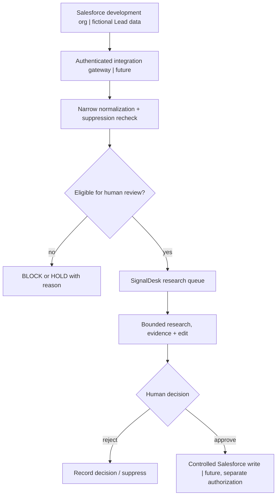

# TAGM Client-to-Value Studio | Salesforce x SignalDesk

**Milestone 1 — Salesforce Lead contract, bounded read-only adapter & presales proof-of-value plan.**

> The Lead contract and bounded read-only REST client are implemented and tested offline with simulated HTTP responses. Live Salesforce authentication is not yet verified. Agentforce, Data 360, production CRM integration and email delivery are not implemented by this milestone.

## Client scenario and discovery

**Fictional buyer:** VP Revenue Operations at a services company whose sales representatives spend time researching accounts, checking CRM suppression, and verifying supporting evidence before outreach.

**Discovery questions**
1. Where is prospect research slowest or duplicated? What is the current weekly baseline?
2. Where are leads mastered—Salesforce or another system—and who owns duplicate resolution?
3. Which teams are accountable for legal review, outreach policy, suppression, and AI outputs?
4. Are there distinct rules by region, channel, business unit, or customer segment?
5. Which signals make research useful enough for a human sales rep to review?
6. What must be true before any automation can update a CRM object?

**Proof-of-value hypothesis:** A bounded research service can reduce manual qualification effort **without** bypassing CRM opt-outs, evidence checks, or a named human review. This is a hypothesis; no time savings, revenue lift, or ROI has been measured.

## Proposed technical integration



**Implemented in this milestone:** `app/salesforce/contract.py` classifies wholly fictional Salesforce-shaped `Lead` records as `review_required`, `blocked`, or `hold`. It requires a valid record identity and company, explicit typed `HasOptedOutOfEmail` / `DoNotCall` / `IsDeleted` flags, and a root company domain. The result contains no contacts or outreach authorization. If the requested fields cannot be read, it holds rather than assuming permission.

**Existing SignalDesk core:** local research and acquisition queue, human review, duplicate checks, Do Not Contact suppression, version-bound draft approvals, and simulated-only delivery. These are **not automatically connected** to the new classifier yet.

**Not built or verified:** OAuth setup, live-org connectivity, CRM writes/sync, Agentforce actions, integration middleware, Data 360, multi-user authentication, production deployment or live quality/value metrics. The tested read-only adapter accepts an externally supplied short-lived OAuth token.

### Offline demonstration

```bash
python -m app.salesforce.demo
python -m pytest -q tests/test_salesforce_contract.py
```

This deterministic fixture is **7 invented Lead records**: 2 review-required, 3 blocked, 2 held; **0 external calls, 0 CRM writes and 0 messages sent**. These counts are fixture assertions, *not* results from a live customer or Salesforce environment.

### Opt-in Salesforce developer-org REST preview — Milestone 1

An implemented but **not live-verified** read-only client uses one HTTPS GET against Salesforce's [documented REST Query resource](https://developer.salesforce.com/docs/platform/api-rest/guide/resources-query.html). It selects only Id, Company, Website, HasOptedOutOfEmail, DoNotCall and IsDeleted, with a static SOQL statement and a limit of 20.

Security boundaries: HTTPS Salesforce My Domain only, OAuth bearer token supplied externally, no redirects, eight-second timeout, no automatic retries, 128 KB response limit, rejection of incomplete/paginated responses, and **aggregate-only printed results**. The underlying CRM identity is not used to authorize outreach or create a lead.

**Only use an authorized Salesforce development org with fictional Lead data.** The My Domain hostname cannot establish that an org is development rather than production. Do not share tokens in ChatGPT or commit them. Salesforce recommends [External Client Apps for new OAuth integrations](https://developer.salesforce.com/docs/platform/api-rest/guide/intro-oauth-and-connected-apps.html).

```bash
export SIGNALDESK_SF_INSTANCE_URL='https://YOUR-DEV-ORG.my.salesforce.com'
export SIGNALDESK_SF_ACCESS_TOKEN='LOCALLY_OBTAINED_SHORT_LIVED_TOKEN'
python -m app.salesforce.read_only_preview
python -m pytest -q tests/test_salesforce_reader.py
```

The `query` endpoint excludes soft-deleted records by default; the contract independently requires an explicit deletion flag. The preview does not persist, update or synchronize CRM records. Live success must be verified before claiming integration. If CRM writes are ever added, fresh authorization, suppression, and duplicate checks must be performed at the point of write.

## Customer acceptance criteria

| Test | Acceptance requirement | Current status |
|---|---|---|
| Suppression | Email opt-out, Do Not Call and deleted flags block an assessed lead | Offline unit tests |
| Missing fields | Missing/invalid required fields result in HOLD, not presumed permission | Offline unit tests |
| Evidence | CRM selection alone cannot approve outreach or establish company fit | Contract design; live integration pending |
| Access | Authenticated Salesforce integration uses restricted scopes and field-level access | Offline tested read-only REST client; OAuth configuration and live scope verification pending |
| Reconciliation | Fresh suppression/duplicate check before an authorized CRM write | Not implemented |
| Reliability | Record observable latency, failures, fallbacks and request costs | Not implemented |
| Governance | Exact reviewer, purpose and approved content logged for any consequential action | Existing SignalDesk local boundary; live CRM pending |
| Commercial value | Compare baseline work time and review outcomes against pilot results | Not measured |

## Commercial case — explicit assumptions only

Define **B** as current manual research minutes per lead, **A** as reviewed AI-assisted minutes per lead, **V** as monthly eligible lead volume, **C** as loaded labor cost/hour, and **P** as monthly platform, model and governance costs.

- Hypothetical monthly labor capacity released = `max(B - A, 0) / 60 × V` hours.
- Hypothetical monthly gross labor value = released hours × `C`.
- Hypothetical monthly net value = gross labor value − `P`.
- Simple payback requires separate one-time implementation cost and validated time measurements.

**Important:** Released staff time is not automatically realized financial savings or incremental revenue. Any claim about conversion lift or sales requires a controlled comparison using customer-owned data and the customer's approval.

## Consulting deliverables and interview walkthrough

1. **Discover:** Interview RevOps, sales leadership, security and CRM administration; baseline effort and customer problem.
2. **Qualify:** Rank business pain and feasibility; decide whether rules, standard CRM features or AI are appropriate.
3. **Architect:** Present build/buy/hybrid options, identities, field permissions, authority boundaries, cost and fallback.
4. **Prove:** Run fixture classification, inspect blocked/held reasons, demonstrate existing SignalDesk review controls.
5. **Commercialize:** Build TCO and sensitivity ranges; clearly separate modeled benefits from observed outcomes.
6. **Deliver:** Present phased implementation, security workstream, change management, acceptance tests, and executive recommendation.

**Next engineering gate:** Configure least-privilege OAuth in a development org, verify a live read-only retrieval against fictional records, and reconcile actual schema and permissions before considering CRM changes.

**Portfolio claim:** "Designed and tested an offline Salesforce suppression-safe qualification contract and a bounded read-only REST client, with a client discovery and proof-of-value plan." No live-org claim yet. **Do not claim a working Salesforce or Agentforce integration until one has been built and verified.**


[Development-org validation runbook](SALESFORCE_DEV_ORG_VALIDATION.md) · [TAGM Client-to-Value Studio](TAGM_CLIENT_TO_VALUE_STUDIO.md)
